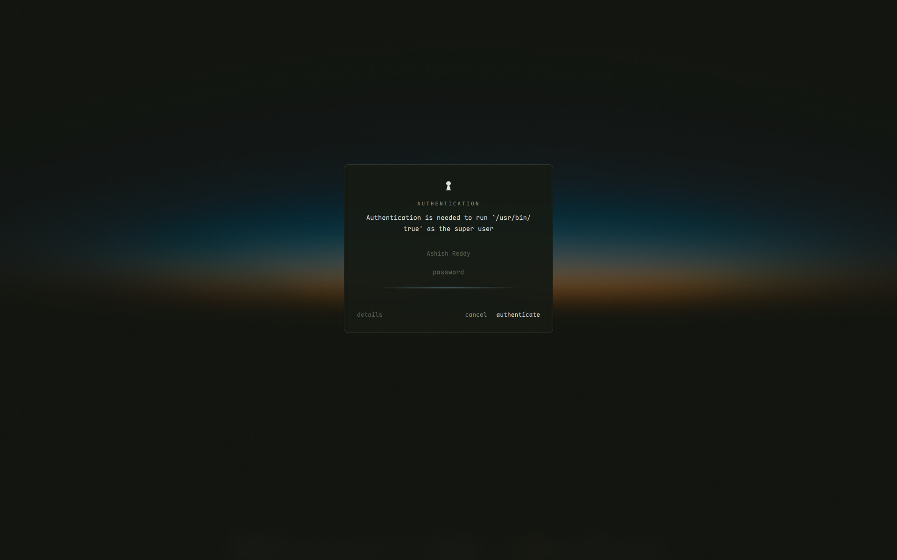
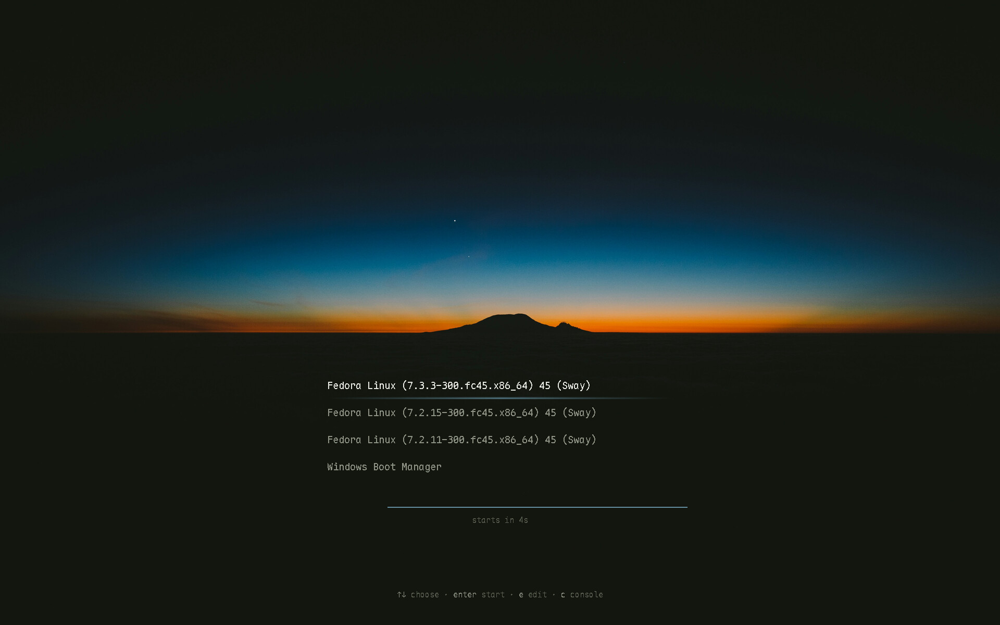

# hyprwm — Horizon

Hyprland + Quickshell session built from the dusk horizon wallpaper.
Runs next to the Sway setup in `~/swaywm`: same palette (`~/swaywm/colors.md`,
plus `sky #06587a` for gradients), same keybindings, separate daemons.
Pick **Hyprland** or **Sway** on the login screen.

The same scene runs from the power button to the desktop: the GRUB menu, the
disk passphrase at boot (Plymouth), the SDDM login, the desktop, and the lock
screen all use the photo, Maple Mono and the horizon line.


Colour appears only where your attention is: the focused window's border
fades from accent to the photo's deep blue, a thin "horizon line" marks the
active workspace, the selected row in a menu and a notification's remaining
time, and amber means a mode is on (REC, AWAKE, DND, PERF). Everything else
stays grey, including app icons until you select them.


## What's in it

**Bar (glow island).** One island per screen, centred at the bottom.
- Left: that screen's workspaces, with a dot per window and the horizon line
  under the active one. A soft glow on the island's top edge drifts after it.
  Next to them, the focused window as
  `App  title`, capped so it never reaches the clock. On an empty workspace,
  or on the screen that doesn't have focus, a quiet system glance: `cpu 56°  mem 5.2 GB  updates 13` (temperature turns
  amber from 85°; updates come from dnf's cache, click to upgrade in kitty).
- Centre: date and time. Click for a month calendar.
- Right: modes only while they're on (REC, AWAKE, DND, PERF in amber, SAVER
  in grey), volume and battery meters, and a `···` tray drawer. The meters'
  sky-to-accent gradient spans the whole track, so the colour itself shows
  the level. Scroll the volume to change it, click it to mute. Its label reads BT while the output is a Bluetooth device. The battery
  reads BAT, CHR or AC, glows softly while charging, and a single sweep of
  light runs along it when the charger is plugged in or out.
- Click the battery for the **power panel**: power profile (saver, balanced,
  performance, via tuned-ppd), a keep-awake switch, and time left and power draw.

**Launcher** (`Super+D`). Apps, a calculator (`=` or `Super+C`, qalc), emoji
(`:` or `Super+.`, types into the focused window), and clipboard history
(`Super+V`, cliphist; `Shift+Delete` removes an entry). Pressing the same key
again closes it. Also a menu mode for scripts: `scripts/qs-dmenu`, a
`rofi -dmenu` stand-in, used by the appearance menu.

**Notifications.** Quickshell is the notification server in this session.
Popups top right, newest first, with a shrinking horizon line for time left
(hover pauses it); critical ones stay and turn red. Same-tag notifications
(brightness, recording, night light) replace each other. `` Super+` `` opens
the notification center: everything not yet dismissed, grouped by app, with
per-item and per-app dismiss, clear all, and a do-not-disturb switch.

**Workspace overview** (`Super+O`). The focused screen's workspaces as small
live screens along the photo's horizon band, over a dimmed, blurred copy of
the wallpaper. Click or Enter to go there, click a window to focus it, drag a
window onto another card to move it; the last card opens a new workspace.

**Ambient screen.** After two minutes without input, every screen fades to the
wallpaper with the clock large in the sky, as on the lock screen. Any key or
mouse movement brings the desktop back. The lock screen still comes at five
minutes, and nothing changes while keep-awake is on.

**Lock screen** (`Super+Shift+Escape`, and after 5 idle minutes or before
sleep). Quickshell's own, in the same style: the clock in the sky above the
mountain, the password as dots over the horizon line (red after a wrong one),
battery at the bottom. `scripts/lock.sh` locks and returns only once the lock
is confirmed; if Quickshell can't lock, **hyprlock locks instead**
(`hypr/hyprlock.conf` is that fallback's look). If Quickshell crashes while
locked, Hyprland stays locked, the restart loop brings it back and it locks
again; config reloads are refused while locked. If you're ever stuck on a red
screen: Ctrl+Alt+F3, log in, then
`hyprctl --instance 0 dispatch 'hl.dsp.exec_cmd("hyprlock")'`.

**Polkit prompt.** Quickshell is the polkit agent: the password prompt for
system actions (pkexec, installing software, power settings) is a card over
the dimmed, blurred desktop, with polkit's own message, the user to
authenticate as (click to switch when there are several), the password on the
horizon line (red and a small shake after a wrong one, CAPS LOCK in amber),
and "details" for the polkit action id. Escape cancels. If Quickshell can't
register as the agent, it starts hyprpolkitagent instead. Try it with
`pkexec true`, which does nothing even when authorized. Long messages stop at
five lines; the full text is under "details".



**Also:** volume and brightness OSD above the bar, power menu that asks before
logging out, rebooting or shutting down, tray menus for nm-applet and
blueman drawn in the same style (not Qt's default), and Papirus-Dark icons for
Quickshell only.

## Motion

Everything that moves runs on near-critically damped springs (ζ ≈ 0.9):
light glides and settles, it doesn't bounce. Hyprland's curves
(`modules/look.lua`) and Quickshell's (`Theme.springs`, integrated per frame
by `Spring.qml`) use the same stiffness, damping and mass, so windows and
panels move alike.

The values were tuned from frame-by-frame screen recordings (wf-recorder at
60 Hz, every frame measured):
- Workspaces drift 20% and cross-fade instead of sliding the full width;
  a 1920 px slide in ~0.3 s jumps 200–400 px per frame and reads as a jerk.
- New windows fade in fast, so the bright horizon band doesn't flash through.
- Panels stay mapped (invisible and click-through while closed), are drawn
  once at startup, and fade in ahead of their rise, so they open on the next
  frame without a hitch.
- Keys reach Quickshell through Hyprland's global shortcuts
  (`Shortcuts.qml`), not by starting `qs ipc` per key press.

## Keys

| Keys | |
| :--- | :--- |
| `Super+Return` · `Super+Shift+Return` | kitty · drop-down kitty |
| `Super+W` · `Super+E` | Brave Origin · Nautilus (new window) |
| `Super+B` | show / hide the bar |
| `Super+Shift+F` | focus mode: do not disturb, bar hidden, windows without focus dimmed; again to restore exactly what was on before |
| `Super+O` | workspace overview: live previews; arrows / 1…0 / click to go, drag a window onto another workspace |
| `Super+D` · `Super+C` · `Super+.` · `Super+V` | launcher: apps · calculator · emoji · clipboard |
| `Super+X` · `Super+Shift+E` | power menu · log out |
| `Super+Ctrl+R` · `Super+Shift+R` | restart Quickshell (also in the power menu) · reload the Hyprland config |
| `Super+Shift+Escape` | lock |
| `Super+Q` | close window |
| `Super+H/J/K/L` (or arrows) | focus; `+Shift` move, `+Ctrl` resize |
| `Super+1…0` · `Super+Shift+1…0` | go to workspace · send window there (stay) |
| `Super+Tab` · `Super+Shift+Tab` | other monitor · send workspace there |
| `Super+F` · `Super+Shift+Space` · `Super+Space` | fullscreen · float · focus tiled/floating |
| `Super+G` · `Super+S` | window group (tabs) · next tab |
| `Super+Shift+B` · `Super+Shift+V` · `Super+T` | next window opens right · below · toggle split |
| `Super+-` · `Super+Shift+-` | scratchpad show · send |
| `` Super+` `` · `` Super+Shift+` `` · `Super+Shift+N` | notification center · clear all · do not disturb |
| `Super+N` · `Super+Shift+A` | night light (follows sunset; press to flip it until the next sunrise or sunset) · appearance (GTK theme, icons, cursor, font) |
| `Super+[` · `Super+]` | brightness (laptop panel or DDC monitor, whichever is focused) |
| `Print` · `Alt+Print` · `Ctrl+Print` · `Shift+Print` | screenshot screen · window · area · record area |
| click the clock · click the battery | calendar · power panel |

Monitors: workspaces 1–5 live on the external Samsung, 6–10 on the laptop,
and move back when a screen returns. Closing the lid turns the laptop panel
off only while another screen is connected.

## Packages (stow, target `~`)

| Package      | Installs to             | What |
| :----------- | :---------------------- | :--- |
| `hypr`       | `~/.config/hypr`        | `hyprland.lua` (Lua config, Hyprland 0.57+) split into `modules/`, hypridle, hyprlock (the lock screen's fallback), scripts, wallpaper |
| `quickshell` | `~/.config/quickshell`  | wallpaper, bar, notifications, OSD, launcher, power menu, power panel, calendar, tray menus, lock screen, polkit prompt |
| `systemd`    | `~/.config/systemd/user` | `hyprland-session.target` (needed for xdg-desktop-portal) and a drop-in keeping kanshi out of Hyprland |
| `kitty`      | `~/.config/kitty`       | terminal, same font and colours as foot |

```sh
cd ~/hyprwm && stow hypr kitty quickshell systemd
```

After adding a new file to a package, run `stow -R <package>` so it gets
linked too. `setup/` isn't stowed: it holds the installers for the login
screen (`setup/sddm.sh`) and the boot screens (`setup/boot.sh`), which need sudo.

## System packages

Hyprland is no longer in Fedora's repos; it comes from the `sdegler/hyprland`
COPR, limited to the Hyprland stack so it can't replace Fedora's waybar or kitty:

```sh
sudo dnf copr enable sdegler/hyprland
sudo dnf config-manager setopt "copr:copr.fedorainfracloud.org:sdegler:hyprland.includepkgs=hypr*,aquamarine*,xdg-desktop-portal-hyprland*,glaze*"
sudo dnf install hyprland hyprlock hypridle hyprpicker hyprpolkitagent hyprsunset \
  xdg-desktop-portal-hyprland quickshell kitty qt6-qt5compat qt6-qtmultimedia \
  papirus-icon-theme-dark
```

hyprpolkitagent is only the fallback now (Quickshell is the polkit agent), and
hyprlock is the lock screen's fallback. For the boot screens:
`plymouth-plugin-script` (Fedora repo) and `python3-pillow` to build them.

Shared with the Sway setup (already installed there): grim, slurp, wl-clipboard,
cliphist, brightnessctl, ddcutil, playerctl, wf-recorder, jq, libnotify,
network-manager-applet, blueman, qalculate (qalc), wtype, tuned-ppd.

`quickshell/.config/quickshell/data/emoji.tsv` was generated once from
rofimoji's emoji CSVs (Unicode CLDR names), so the launcher doesn't need rofimoji.

## Login screen (SDDM)

`setup/sddm.sh` installs the **horizon** SDDM theme: the dusk wallpaper, the
clock in the sky, the password on the horizon line (red after a wrong
password, CAPS LOCK in amber), and a bar-style island with the session
(Hyprland / Sway, click to switch) and suspend / reboot / shut down. With two
screens the form goes on the larger one; the other shows the wallpaper.

```sh
setup/sddm.sh --test        # preview in a window, nothing installed
setup/sddm.sh               # install (sudo); shows at the next login screen
setup/sddm.sh --uninstall   # back to the "mono" theme from ~/swaywm
```

It only adds `/etc/sddm.conf.d/20-horizon.conf` (theme switch) and the theme
directory; the greeter's compositor setup (outputs, input, lid) stays with
`~/swaywm/setup/sddm.sh`. If the greeter ever breaks: Ctrl+Alt+F3, log in,
`sudo rm /etc/sddm.conf.d/20-horizon.conf && sudo systemctl restart sddm`.

## Boot screens (GRUB and Plymouth)

`setup/boot.sh` installs the screens before the login, in the same scene:
- **GRUB menu:** the photo, the menu on the ground below the horizon, the
  chosen entry white with the horizon line under it, and a countdown line that
  shrinks (any key stops it).
- **Plymouth splash:** the photo fades up from black. The disk passphrase is
  dots over the horizon line, red after a wrong one, CAPS LOCK in amber. Once
  the disk opens, a point of light runs along the photo's horizon while the
  system starts. Shutdown and restart run the light back and darken the photo.



```sh
sudo dnf install plymouth-plugin-script   # Fedora repo
setup/boot.sh --dry-run        # what would change
setup/boot.sh --preview-grub   # the GRUB menu in a QEMU window (needs qemu-system-x86-core, edk2-ovmf)
setup/boot.sh --test           # the splash, from a text console (Ctrl+Alt+F3)
setup/boot.sh                  # install both (sudo); --only grub|plymouth for one
setup/boot.sh --uninstall      # back to the text menu and "bgrt"
```

The GRUB theme goes in `/boot/grub2/themes/horizon`, switched on by
`/boot/grub2/custom.cfg`, which Fedora's grub.cfg already loads. grub2-mkconfig
is never run, so the boot entries (Windows included) stay as they are. The
splash rebuilds the initramfs (`plymouth-set-default-theme -R`). Every word on
the splash is drawn into a PNG at build time (`setup/boot/build.py`), so it
doesn't need fonts during early boot.

Before installing, the script takes a snapper snapshot of `/` ("before
Horizon boot themes") and, since `/boot` is a separate partition outside the
snapshot, keeps the running kernel's initramfs as
`/boot/initramfs-<version>.img.pre-horizon`. `--preview-grub` boots Fedora's
own GRUB in QEMU; without `qemu-ui-gtk` it saves screenshots instead of
opening a window.

If boot goes wrong: a broken GRUB theme falls back to the text menu, and a
broken splash falls back to a text passphrase prompt (Esc shows it at any
time). Last resort: in GRUB press `e`, delete `rhgb quiet`, `Ctrl+X`, then
`setup/boot.sh --uninstall`.

## Wacom tablet (Intuos BT S)

Works over USB and Bluetooth (pair once with `bluetoothctl`, then `trust` it so
it reconnects by itself).

- **Pen mapping** — `modules/tablet.lua` maps the pen to the monitor Obsidian
  is on (move Obsidian to the other screen and the pen follows), else the
  Samsung, else the laptop panel. The tablet area is cropped to the screen's
  shape (16:9 for the Samsung; the 16:10 laptop panel uses the whole surface)
  so strokes aren't stretched. It re-runs when a monitor or Obsidian window
  is added, closed or moved. Layout I use: notes on the Samsung (straight
  ahead), video/tutorial on the laptop to the left.
- **Pad buttons** — Hyprland has no pad bindings, so `scripts/wacom-pad.py`
  reads the pad and types shortcuts through a virtual keyboard. It is started
  from `modules/autostart.lua` and survives the tablet disconnecting.

  | Key | Everywhere | Obsidian, on an `.excalidraw` drawing |
  |---|---|---|
  | 1 | Undo (`Ctrl+Z`) | |
  | 2 | Play/pause media (`playerctl`) | |
  | 3 | | Eraser (`E`) |
  | 4 | | Pen (`P`) |

  To change a button, edit the `PROFILES` block at the top of the script (it
  explains the syntax), then restart it: `pkill -f wacom-pad.py` and start
  `~/.config/hypr/scripts/wacom-pad.py` again (or log out and in).
  A value starting with `!` runs a command instead of a key (key 2 does that).
  `wacom-pad.py learn` prints each button you press with the focused window's
  class and title, for writing new rules.
- **One-time system setup** (not in the repo):
  `sudo dnf install python3-evdev` and `/etc/udev/rules.d/70-wacom-pad.rules`,
  which gives the logged-in user read access to the pad and `/dev/uinput`:

  ```
  SUBSYSTEM=="input", KERNEL=="event*", ATTRS{name}=="Wacom Intuos BT S Pad", TAG+="uaccess"
  KERNEL=="uinput", SUBSYSTEM=="misc", TAG+="uaccess", OPTIONS+="static_node=uinput"
  ```

## Checking changes

```sh
Hyprland --verify-config                 # Lua config errors, without reloading
hyprctl configerrors                     # inside a running session
qs ipc call shell reload                 # reload Quickshell (edits to stowed files aren't always noticed)
qs ipc show                              # IPC targets for scripts (launcher, power, notifications, osd, shell, lock, polkit)
qs ipc call polkit status                # "registered" when Quickshell is the polkit agent
hyprctl globalshortcuts                  # the quickshell:* shortcuts the keys use
```

If the bar or a panel gets into a bad state, `Super+Ctrl+R` (or "Restart shell"
in the power menu) restarts Quickshell (`scripts/qs-restart.sh`). It is a
Hyprland bind, so it works even when Quickshell is stuck; it does nothing while
the lock screen is up. If the launcher, power menu or notification keys stop
responding, Quickshell isn't running: press `Super+Ctrl+R`.

## Not shared with Sway

kanshi (Hyprland handles monitors itself: `modules/monitors.lua`), waybar,
dunst, rofi, swayidle/swaylock, foot, the polkit agent. Keep-awake state is separate too
(`$XDG_RUNTIME_DIR/hypr-keep-awake`). Shared: gsettings (appearance), the
power profile (tuned-ppd), and the clipboard history.
