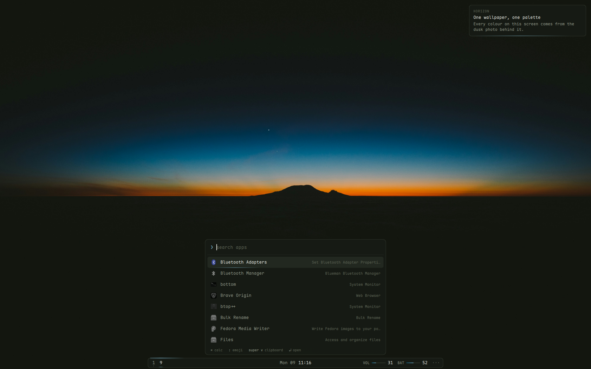
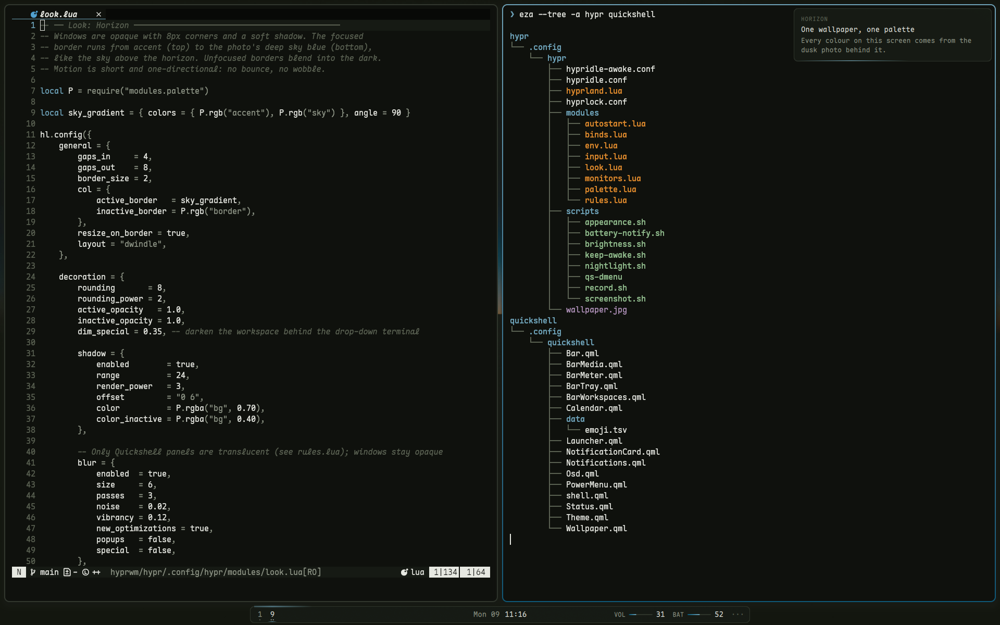

# hyprwm — Horizon

Hyprland + Quickshell session built from the dusk horizon wallpaper.
Runs next to the Sway setup in `~/swaywm`: same palette (`~/swaywm/colors.md`,
plus `sky #06587a` for gradients), same keybindings, separate daemons.
Pick **Hyprland** or **Sway** on the login screen.



Colour appears only where your attention is: the focused window's border
fades from accent to the photo's deep blue, a thin "horizon line" marks the
active workspace, the selected launcher row and the notification timer, and
amber means a mode is on (REC, AWAKE, DND). Everything else stays grey.



| Keys | |
| :--- | :--- |
| `Super+D` | launcher (`=` calculator, `:` emoji) |
| `Super+V` | clipboard history |
| `Super+X` | power menu |
| `Super+Shift+A` | appearance (GTK theme, icons, cursor, font) |
| `Super+H/J/K/L` (+`Shift` move, +`Ctrl` resize) | focus, move and resize windows |
| `Super+Shift+Return` | drop-down terminal |
| click the clock | calendar |

## Packages (stow, target `~`)

| Package      | Installs to             | What |
| :----------- | :---------------------- | :--- |
| `hypr`       | `~/.config/hypr`        | `hyprland.lua` (Lua config, Hyprland 0.57+) split into `modules/`, hypridle, hyprlock, scripts, wallpaper |
| `quickshell` | `~/.config/quickshell`  | wallpaper, bar (glow island), notifications, OSD, launcher (apps / calc / emoji / clipboard), power menu |
| `systemd`    | `~/.config/systemd/user` | `hyprland-session.target` (needed for xdg-desktop-portal) and a drop-in keeping kanshi out of Hyprland |
| `kitty`      | `~/.config/kitty`       | terminal, same font and colours as foot |

```sh
cd ~/hyprwm && stow hypr kitty quickshell systemd
```

## System packages

Hyprland is no longer in Fedora's repos; it comes from the `sdegler/hyprland`
COPR, limited to the Hyprland stack so it can't replace Fedora's waybar or kitty:

```sh
sudo dnf copr enable sdegler/hyprland
sudo dnf config-manager setopt "copr:copr.fedorainfracloud.org:sdegler:hyprland.includepkgs=hypr*,aquamarine*,xdg-desktop-portal-hyprland*,glaze*"
sudo dnf install hyprland hyprlock hypridle hyprpicker hyprpolkitagent hyprsunset \
  xdg-desktop-portal-hyprland quickshell kitty qt6-qt5compat qt6-qtmultimedia
```

Shared with the Sway setup (already installed there): grim, slurp, wl-clipboard,
cliphist, brightnessctl, ddcutil, playerctl, wf-recorder, jq, libnotify,
network-manager-applet, blueman, qalculate (qalc), wtype.

`quickshell/.config/quickshell/data/emoji.tsv` was generated once from
rofimoji's emoji CSVs (Unicode CLDR names), so the launcher doesn't need rofimoji.

## Checking changes

```sh
Hyprland --verify-config                 # Lua config errors, without reloading
hyprctl configerrors                     # inside a running session
qs ipc call shell reload                 # reload Quickshell (edits to stowed files aren't always noticed)
qs ipc show                              # all IPC targets (launcher, power, notifications, osd, shell)
```

## Not shared with Sway

kanshi (Hyprland handles monitors itself: `modules/monitors.lua`), waybar,
dunst, rofi, swayidle/swaylock, foot. Keep-awake state is separate too
(`$XDG_RUNTIME_DIR/hypr-keep-awake`).
